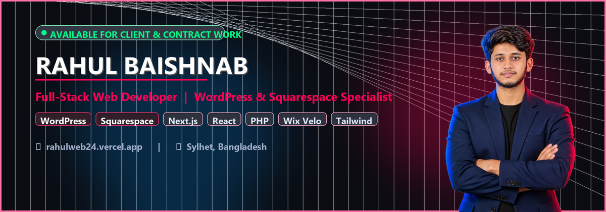
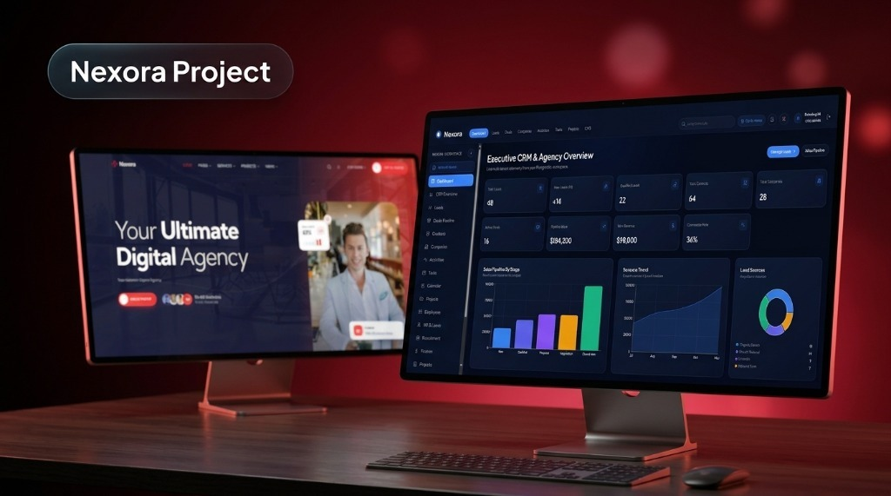

  

    

  

    
  

  

    
    
    
    
    
  

---

### 👨‍💻 About Me

<table>
<tr>
<td width="65%" valign="top">

I'm **Rahul Baishnab**, a Senior-Level Full-Stack Web Developer and **WordPress & Squarespace Specialist** based in **Sylhet, Bangladesh**. 

With 2+ years of commercial client delivery, I specialize in combining modern JavaScript engineering (React, Next.js, TypeScript) with advanced CMS development (WordPress, Squarespace, Wix Velo, and custom PHP). I don't just build websites; I engineer scalable, fast, and bespoke digital solutions tailored to client business needs.

- 🔌 **WordPress Engineering:** Advanced custom plugin architecture, custom themes coded from scratch, Elementor Pro widgets, Divi Modules, custom Gutenberg blocks, and CRM systems.
- ✨ **Squarespace & Wix Engineering:** Taking standard templates beyond limits using custom JavaScript, CSS, custom layouts, and Wix Velo backend functions.
- ⚡ **Full-Stack Applications:** Scalable Next.js/React applications with real-time features (e.g. **DeshLine** bus ticketing with atomic seat locks).
- 🚀 **Performance & Quality:** 95+ Google PageSpeed scores, sub-second load times, cross-browser compatibility, and robust security.
- 📍 **Location:** Sylhet, Bangladesh 🇧🇩
- 💼 **Available for:** Freelance client projects, agency contracts, and remote engineering roles.

</td>
<td width="35%" align="center" valign="middle">

  

**🟢 Status:** Available for Projects  
**🏆 Specialties:** WordPress & Squarespace  
**🚀 Experience:** 2+ Years Commercial  

</td>
</tr>
</table>

---

### ⚡ CMS & Platform Specialization

<table>
<tr>
<td width="50%" valign="top">

#### 🔌 WordPress Engineering Excellence

I provide end-to-end WordPress solutions from bespoke backend code to pixel-perfect frontend layouts:

* **Custom Plugin Development:** Purpose-built admin tools, custom CRMs, database tables, and REST API endpoints.
* **Custom Theme Development:** Clean, semantic PHP themes built from scratch without bloat.
* **Page Builders & Editors:** Advanced Elementor Pro custom widgets, Divi Modules, and Gutenberg custom React blocks.
* **WooCommerce Solutions:** Custom checkout workflows, product configurators, and payment gateway integrations.
* **Speed Optimization & Security:** Caching setups, database cleaning, and hardening against vulnerabilities.

  
  
  
  
  

</td>
<td width="50%" valign="top">

#### ✨ Squarespace & Wix Engineering

Transforming standard website builders into custom, dynamic, high-converting platforms:

* **Advanced Squarespace Customization:** Extending Squarespace templates with custom JavaScript logic and CSS styling.
* **Bespoke Interactions & Layouts:** Custom sliders, interactive accordions, dynamic filtering, and custom typography.
* **Wix Velo Development:** Custom database collections, backend web modules, dynamic pages, and third-party API webhooks.
* **Custom E-Commerce:** Custom cart flows, customized product pages, and automated confirmation workflows.
* **Technical SEO & Analytics:** On-page structured data, Google Search Console integration, and responsive layout polish.

  
  
  
  

</td>
</tr>
</table>

---

### 🛠️ Technical Stack & Skills Matrix

#### 🎨 CMS & E-Commerce Platforms

  
  
  
  
  
  
  

#### 💻 Frontend Engineering

  

#### ⚙️ Backend & Database Architecture

  

#### 🔧 Development Tools & DevOps

  

---

### 🚀 Featured Projects

<table>
<tr>
<td width="50%" valign="top">

#### ⚡ Nexora — Digital Agency & CRM Platform
*High-converting digital agency platform unified with multi-tenant business CRM.*

- 📊 **Executive CRM Dashboard** with lead tracking, deal pipelines & revenue KPIs.
- 🎯 **Interactive Conversion Funnel** and high-converting service showcases.
- 👥 **Multi-Tenant Workspace** for project delivery, team tasks & operations.
- ⚡ **Stack:** Next.js, React, TypeScript, Tailwind CSS, CRM Architecture.

  

</td>
<td width="50%" valign="top">

#### 🚌 DeshLine Paribahan — Bus Ticketing System
*A real-world intercity coach network platform built for speed and reliability.*

- 🎟️ **Live Interactive Seat Selection** with real-time seat status.
- 🔒 **5-Minute Atomic Seat Lock** to prevent duplicate bookings across counters.
- 📱 **Instant PNR & QR Code E-Tickets** for passengers and counter dispatchers.
- ⚡ **Stack:** Next.js, React, TypeScript, Tailwind CSS.

  
  

</td>
</tr>
<tr>
<td width="50%" valign="top">

#### 🧩 Custom WordPress Plugins & Themes
*Bespoke enterprise WordPress development from scratch.*

- ⚙️ **Custom Admin Dashboards** with feature toggles, CRM workflows, and activity logs.
- 🔌 **REST API & Webhooks** integrating WordPress with external platforms.
- 🧱 **Custom Gutenberg Blocks & Elementor Widgets** built with native PHP and React.
- 🚀 **Speed Optimization** with sub-second loading and 95+ PageSpeed scores.

  

</td>
<td width="50%" valign="top">

#### ✨ Squarespace & Custom Web Engineering
*High-converting Squarespace and modern custom frontends.*

- 🎨 **Custom JavaScript & CSS Injection** taking templates beyond defaults.
- 📱 **Pixel-Perfect Responsive Layouts** tuned for mobile, tablet, and desktop.
- 🛒 **Custom E-Commerce & Checkout** flows with dynamic filtering.
- ⚡ **SEO & Performance Optimization** with structured data and quick load speeds.

  

</td>
</tr>
</table>

---

### 📊 GitHub Activity & Metrics

  

---

### 📬 Let's Connect & Build Together!

Whether you need a custom WordPress plugin, a high-converting Squarespace website, or a scalable full-stack web application — feel free to reach out anytime!

&nbsp;

&nbsp;

&nbsp;

  

  <i>⭐ Designed with passion by <b>Rahul Baishnab</b></i>

